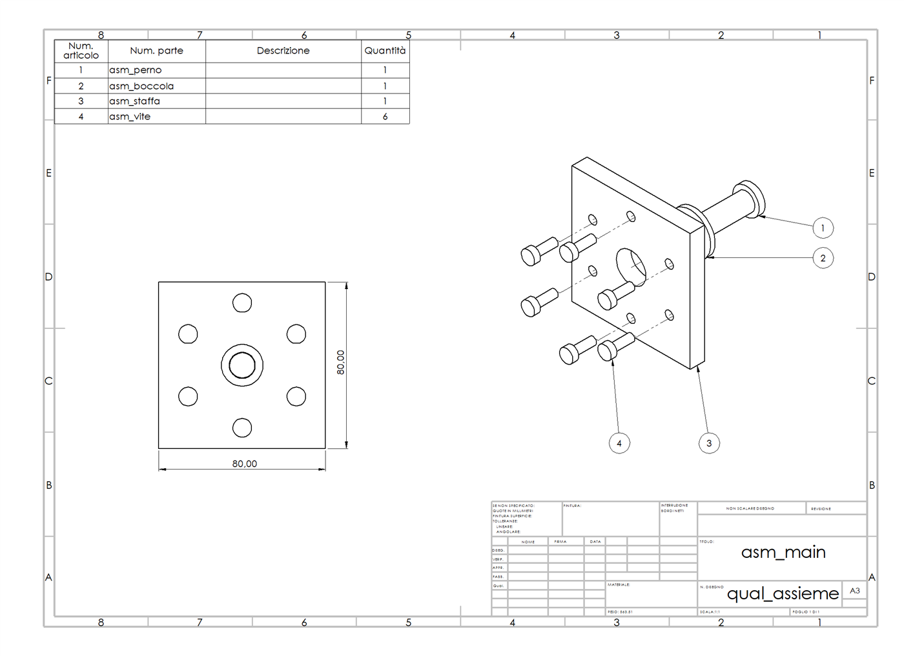
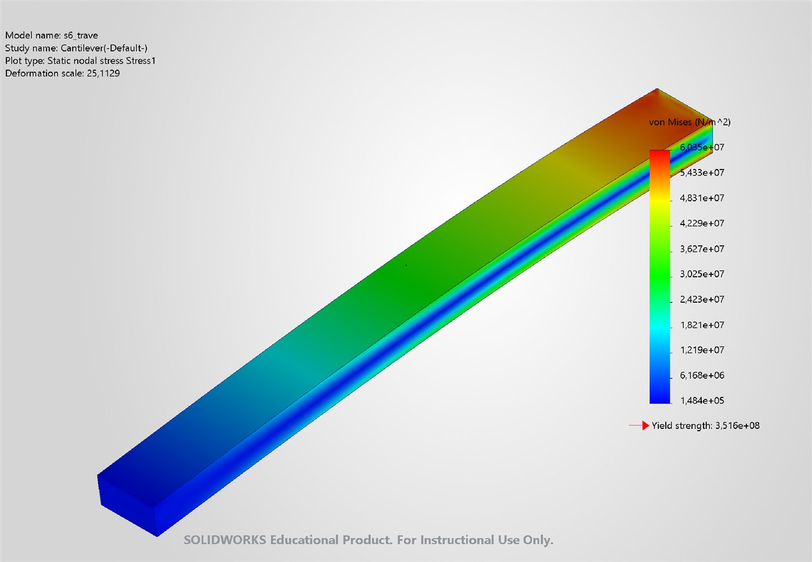

# SolidWorks MCP

**Let Claude drive SOLIDWORKS.** Describe a part, an assembly, a drawing or a simulation in plain words, and the model builds it in SOLIDWORKS for you, then checks the result with real numbers.

[](https://github.com/elo-savage/solidworks-mcp/actions/workflows/test-offline.yml)


[](LICENSE)

> *"Make a Ø120 × 15 mm flange with six M8 holes on a Ø90 circle and a Ø30 bore, in AISI 304. Put it on an A3 drawing with dimensions and export a PDF."*
>
> The server creates the part, checks that the volume is 153 317.58 mm³ and the mass 1.22654 kg (matching the hand calculation), lays out an ISO drawing with dimensions and exports the PDF.

<p align="center">
  
  
</p>
<p align="center"><sub>Left: assembly drawing with BOM and balloons. Right: static study of a cantilever beam. Both were produced only through MCP tool calls.</sub></p>

---

## What is this?

An [MCP](https://modelcontextprotocol.io/) server, written in Python, that connects AI clients such as **Claude Code** and **Claude Desktop** to **SOLIDWORKS** on Windows. It talks to SOLIDWORKS through the official COM API and gives the model **376 tools** (375 without `execute_python`). With them it can sketch, model, assemble, make drawings, export, and run FEA studies.

Every tool has been tested against a live SOLIDWORKS session. The tests build real parts and compare **measured numbers** (volumes, masses, dimensions, positions, reaction forces, stresses) with values calculated by hand. A tool only counts as done when those numbers match.

## Features

| Area | Tools | What it can do |
|---|:---:|---|
| 🧱 **Core & Documents** | 27 | Connect to live or dedicated instance; batch tool sequence execution; tool search & discovery; new/open/save/close; units; basic sketches; primitive extrusions, cuts, fillets and chamfers |
| 📐 **Modeling & Sketching** | 149 | Advanced 2D/3D sketching (rebuild diagnostics & error inspection); (centerlines, 3-point/tangent arcs, ellipses, parabolas, conics, splines, blocks, dynamic mirror, power trim); boss/cut lofts, sweeps, boundary features, ribs, domes, wraps, flex, cosmetic & modeled threads; multibody combine, split, intersect, scale; linear, circular, curve, sketch, table, and fill patterns |
| 🌀 **Curves & Surfaces** | 21 | Standard & variable-pitch helices, spirals, projected & composite curves, split lines; planar surface from sketch, surface extrude, revolve, sweep, loft, offset, knit, extend, untrim, ruled surface |
| 📄 **Drawings** | 39 | ISO sheets (first-angle projection, A4–A0 portrait/landscape); automatic layout & scaling; standard, projected, section, detail, auxiliary, broken & crop views; clean automatic dimensioning; tolerances, GD&T, surface finish; hole tables, BOM, balloons; PDF/DXF/DWG export |
| ⚙️ **Assemblies** | 53 | Component insertion (floating/fixed); standard, advanced & limit mates; component patterns (linear, circular, feature-driven, chain); mirroring with opposite-hand parts; copy with mates; exploded views (linear, entity-aligned, radial); mate controller; belt & chain features; hole alignment checks; measured degrees of freedom; Pack & Go |
| 🏭 **Sheet Metal & Weldments** | 17 | Base flanges, edge flanges, hems, sketched bends, swept flanges, normal cuts, forming tools, corner relief / trim, flat pattern unfolding & 1:1 DXF export; structural members, weldment profiles, trim/extend, end caps, cut lists |
| 🔍 **Selection & Inspection** | 16 | SelectByID2, 3D raycasting selection, B-Rep topology query by geometric criteria, active selection management; viewport orientation, zoom to fit, labeled viewport image badge export; bounding boxes, center of mass, mate references, draft & thickness analysis, undercut analysis, geometry check |
| 📦 **Data & Export** | 31 | Materials (including custom libraries); mass properties & inertia tensors (model origin, CG, or user coordinate system); custom properties; equations; configurations (tables via CSV/JSON); STEP/IGES/Parasolid/STL/3MF/3D PDF/eDrawings export with integrity check; import; high-res images |
| 🔬 **Simulation (FEA)** | 23 | Static, frequency, buckling and steady-state thermal studies; fixtures, forces, torques, pressure, gravity, temperature, bearing & remote loads; global and local contacts (bonded, no-penetration); standard & curvature-based mesh with local mesh controls; automated solver; results (von Mises, displacements, strains, heat flux, FOS location, reaction forces/moments); color plots |

### Things you can ask

- *"Mate the pin into the bushing and tell me how many degrees of freedom are left."*
- *"Assign AISI 304 and give me the mass and the center of gravity."*
- *"Fix the left face, put 100 N on the right face and tell me the maximum deflection."*
- *"Create three configurations, 150, 200 and 250 mm long, and export each one as STEP."*
- *"Make an exploded view of the assembly and put it on a drawing with a BOM."*

### Vision LLMs & Native ImageContent

When capturing screenshots, rendered views, simulation plots, or labeled viewport images (`export_model_image`, `export_simulation_plot`, `export_labeled_viewport_image`, and `export_drawing` to PNG/JPG), the server returns both structured JSON metadata in `TextContent` and the image as native MCP `ImageContent` (base64-encoded).

Multimodal Vision LLMs (e.g. Claude 3.5/3.7 Sonnet) receive the rendered CAD geometry directly in their context window for immediate visual verification and geometric feedback. Image attachment also works seamlessly inside batch workflows (`execute_tool_sequence`).

### MCP Resources & Prompts

The server implements full standard MCP resource and prompt protocols:

- **Resources:**
  - `solidworks://status`: Live connection state, SolidWorks version, PID, mode, UI language, and default unit.
  - `solidworks://documents`: List of open documents, file paths, modified flags, and active document marker.
  - `solidworks://active-document`: Deep inspection of the active document (configurations, assigned material, solid bodies count, sheets).
  - `solidworks://configuration`: Server parameters, timeouts, active toolset groups, and logging paths.
- **Prompts:**
  - `create-part`: Guided workflow for parametric 3D modeling with sketches, features, and mass property verification.
  - `create-drawing`: Guided workflow to generate an ISO drawing sheet with standard views, dimensions, and PDF export.
  - `run-simulation`: Guided workflow for FEA studies (static, frequency, buckling, thermal) with load setup and FOS review.
  - `create-assembly`: Guided workflow for multi-component assemblies, mating kinematics, and exploded views.
  - `export-model`: Guided workflow for CAD model exchange (STEP, STL, 3MF, etc.) with format integrity checks.

## Tested scenarios

Seven real end-to-end runs are documented step by step in [`docs/esempi/`](docs/esempi/README.md): the request, every tool call with its result, and the measured numbers. They were last re-run on a clean install on 2026-10-18. The scenario files are written in Italian; the tool calls and numbers can be read in any language.

| # | Scenario | Measured result |
|---|---|---|
| S1 | Flange with holes, A3 drawing, PDF | Volume 153 317.58 mm³, mass 1.22654 kg, same as the hand calculation |
| S2 | L-bracket with fillet, slots and chamfers | Volume 30 356.6 mm³, as calculated |
| S3 | Pin and bushing assembly | 2 degrees of freedom; BOM with 3 rows; 3 balloons |
| S4 | Cantilever beam, static study | Deflection 0.797 mm (theory 0.800); 30.05 MPa at mid-span (theory 30); FOS 5.83 |
| S5 | Configurations from a CSV table | Volumes 30 000 / 40 000 / 50 000 mm³; three valid STEP files |
| S6 | S1 and S4 with SOLIDWORKS in English | Same numbers as in Italian |
| S7 | Closing a document with unsaved changes | Refused, with an explanation, unless you pass `save` or `discard` |

## Requirements

- **Windows 10/11** with a licensed **SOLIDWORKS** installation. Developed and tested on **SOLIDWORKS 2026 SP4.1**; other versions have not been tested.
- **Python 3.10+, x64 build.** On Windows on ARM, use the x64 Python from python.org: it runs emulated, and the ARM64 build does not work because some dependencies have no ARM64 wheels.
- The **SOLIDWORKS Simulation** add-in, only for the simulation tools.

## Installation

```bash
git clone https://github.com/elo-savage/solidworks-mcp.git
cd solidworks-mcp
python -m venv .venv
.venv\Scripts\pip install -e .
```

This installs the dependencies and the command `.venv\Scripts\solidworks-mcp.exe`. The editable install (`-e`) is needed because the server writes portrait sheet formats into the project's `formats/` folder.

To check that the Python is x64, run `python -c "import sysconfig; print(sysconfig.get_platform())"`: it must print `win-amd64`. Do not rely on `platform.machine()`: on ARM64 PCs it prints `ARM64` even for the emulated x64 Python.

### Connect it to your client

**Claude Code**
```bash
claude mcp add solidworks -- C:\path\to\solidworks-mcp\.venv\Scripts\solidworks-mcp.exe
```

**Claude Desktop**: edit `%APPDATA%\Claude\claude_desktop_config.json`:
```json
{
  "mcpServers": {
    "solidworks": {
      "command": "C:\\path\\to\\solidworks-mcp\\.venv\\Scripts\\solidworks-mcp.exe"
    }
  }
}
```

Start SOLIDWORKS, restart the client and ask *"connect to SolidWorks"*.

> **Tip:** to keep your own SOLIDWORKS window untouched, add `"env": {"SW_MCP_INSTANCE": "dedicated"}`. The server then starts its own hidden SOLIDWORKS instance and closes only that one at the end.

## Configuration

**`solidworks_mcp/config.json`** sets:
- the path of `SLDWORKS.exe` (`auto` finds it automatically);
- the startup timeout and the maximum time per tool (`tool_timeout`, default 300 s);
- the default unit;
- the log level and log file. Logs go to `%LOCALAPPDATA%\solidworks-mcp\`, rotating over 5 files of 5 MB.

Part, assembly and drawing templates are the SOLIDWORKS defaults (*Options › Default Templates*).

**Environment variables**

| Variable | Effect |
|---|---|
| `SW_MCP_INSTANCE=dedicated` | Use a private, hidden SOLIDWORKS instance instead of the one you have open |
| `SW_MCP_AUTORESTART=1` | If the dedicated instance dies or times out, the next tool restarts it and warns that open documents were lost |
| `SW_MCP_TOOL_TIMEOUT` | Maximum seconds per tool (overrides `tool_timeout`). On timeout, the server returns an error; it closes a dedicated instance, but never touches yours |
| `SW_MCP_TOOLSETS` | Expose only some tool groups, e.g. `base,modeling,drawings` (groups: `base`, which is always on, `modeling`, `drawings`, `assembly`, `data`, `simulation`). Fewer tools means shorter descriptions sent to the model |
| `SW_MCP_EXE`, `SW_MCP_ARGS`, `SW_MCP_STARTUP_TIMEOUT` | How the dedicated instance is launched (defaults: auto, `/r`, 240 s) |
| `SW_MCP_ALLOW_PYTHON=1` | Enable `execute_python`, which runs arbitrary Python on your PC. Off by default; with it off, the client sees 371 tools |
| `SW_MCP_ATTACH_IMAGES=0` | Disable inline `ImageContent` attachments for image exports (default `1`, enabled) |

## Safety

- Tools that delete or overwrite are marked **destructive**, so the client asks for confirmation.
- Save and export **never overwrite** an existing file unless you pass `overwrite=true`.
- `close_document` **refuses to throw away unsaved work** unless you pass `save=true` or `discard=true`.
- Export/import options are global SOLIDWORKS preferences: the server reads them, changes them for the export, and **always restores** them.
- `execute_python` is disabled unless you enable it on purpose.

## Language support

The server works with SOLIDWORKS in **Italian or English** with no setup: it detects the interface language at each connection. It never relies on names written in one language. It finds standard planes and the origin by their position in the feature tree and feature types by their internal type names, and it asks SOLIDWORKS for templates and libraries in the current language. The full test suite has been run in both languages.

The texts written on drawings and in plots follow the SOLIDWORKS language. The **server's own messages are in Italian**; MCP clients handle that without problems. Other SOLIDWORKS languages have not been tested.

## Known limitations

Each of these limitations has been tested, and the affected tool reports it in its result:

- **STEP AP242** cannot be written through the API on the Student edition, where the file comes out as AP203. AP214 works.
- **Exploded views:** SOLIDWORKS 2026 does not store a rotation inside a translation step. Rotation works in radial steps, and the tool suggests that workaround.
- **UNI** hole standards are missing from the SOLIDWORKS Hole Wizard database. Above M20 the database also lacks some sizes (M60 clearance, M68, M70; counterbores only M24-M64 in steps, no countersinks): simple and tapped holes of those sizes are made as a generic hole with the computed diameter (flat bottom if blind) plus a cosmetic thread.
- A local no-penetration contact that opens under load (a part held only by the contact) can make the solver run until the timeout.
- Saving a part right after a simulation can take a few minutes.

Any edge case or limitation encountered during automation is reported directly in the tool execution results with guidance on workarounds.

## Tests

```bash
python tests/test_offline.py                          # no SOLIDWORKS needed (runs on Linux and CI on every push)
.venv\Scripts\python.exe tests\test_modeling_live.py  # targeted live tests on dedicated hidden instance
.venv\Scripts\python.exe tests\run_all.py             # full regression (12 suites, 1853/1853 PASS), summary in test_output\
```

The live tests build parts **only through the MCP tools** and compare the measured numbers with expected values. All 1853 checks in the regression suite pass with 100% green status on a dedicated instance with zero orphan processes.

## Credits and license

The project started from [alisamsam/solidworks-mcp](https://github.com/alisamsam/solidworks-mcp) by Samsaam Ali Baig, which had 22 basic tools. It was then rewritten and extended to 372 tools by Elia Venturi ([@elo-savage](https://github.com/elo-savage)).

Released under the [MIT License](LICENSE). SOLIDWORKS is a trademark of Dassault Systèmes; this project is not affiliated with or endorsed by Dassault Systèmes.
